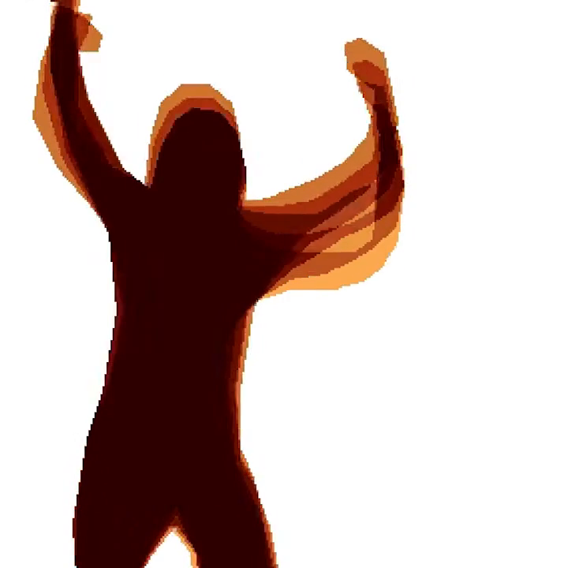

# RetroSilhouetteKit

A real-time, audio-reactive retro silhouette motion-trail engine.

This frame comes from the 1992 Amiga demo *State of the Art* by Spaceballs, the production this project was inspired by.

This frame comes from RetroSilhouetteKit. The WebAssembly core took a photo of a dancer and rendered it at 720 × 720 with four echo layers.

## How it works

The engine thresholds each frame into a foreground mask, stores the mask in a 96-frame ring, and draws the last few masks as colour echoes behind the current silhouette. A palette supplies the background gradient and eight trail colours. The iOS build adds bass cuts, camera zoom cuts, and audio-driven layer counts.

## Platforms

- **iOS** (`ios/`) – Swift package for iOS 15+, with camera input, a built-in synth, and SwiftUI/UIKit views. See [ios.md](./ios.md).
- **WebAssembly** (`wasm/`) – portable C99 core with no libc, plus a browser demo page. See [wasm.md](./wasm.md).

## Documentation

- [ios.md](./ios.md) – features, installation, usage, and the full configuration API.
- [wasm.md](./wasm.md) – build steps, module API, demo page, and limits.

## Credits

The effect is inspired by *State of the Art* (Spaceballs, 1992). The second image uses a photo by MarylandGeoffrey from Wikimedia Commons, licensed CC BY-SA 4.0.

## License

This project is licensed under the MIT License. Copyright (c) 2026 Tom Sella. See [LICENSE](./LICENSE) for the full text.
